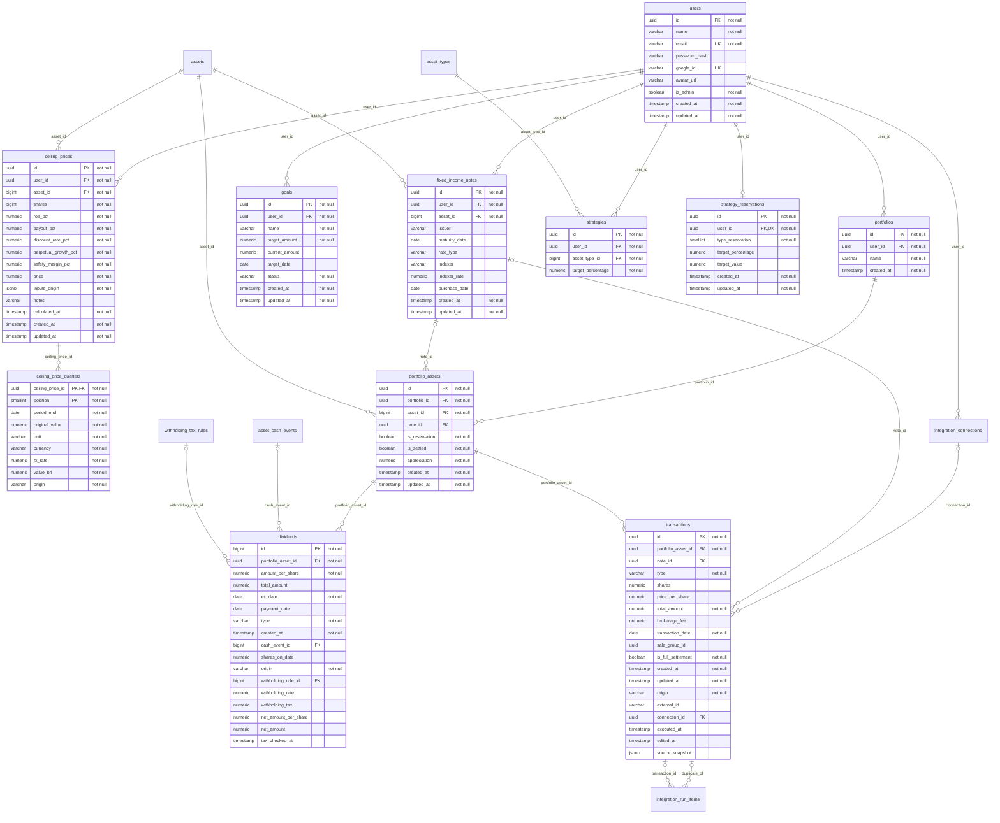
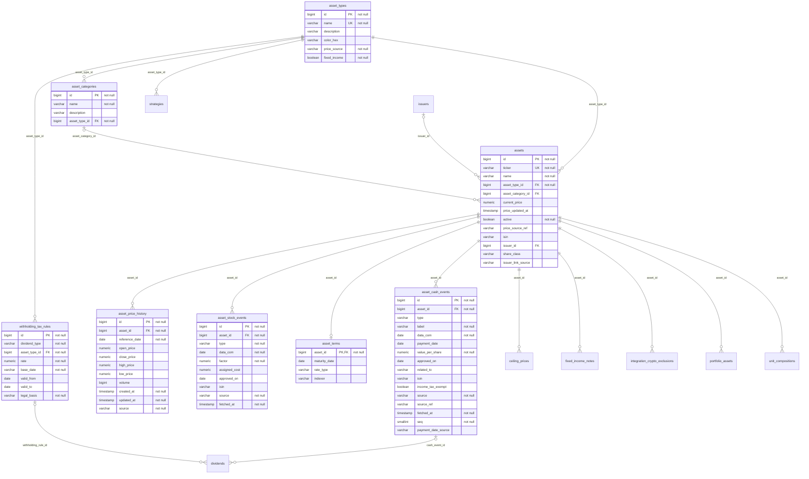
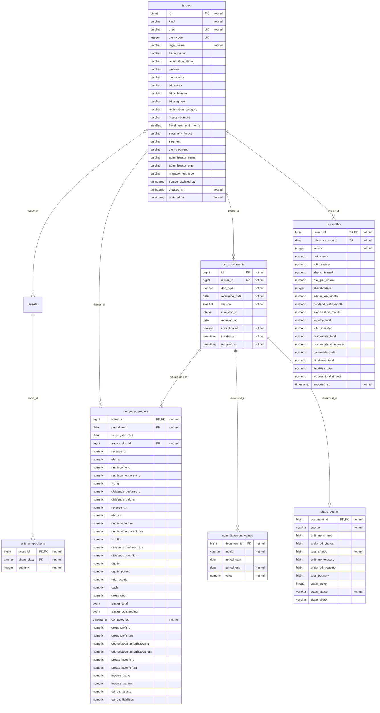
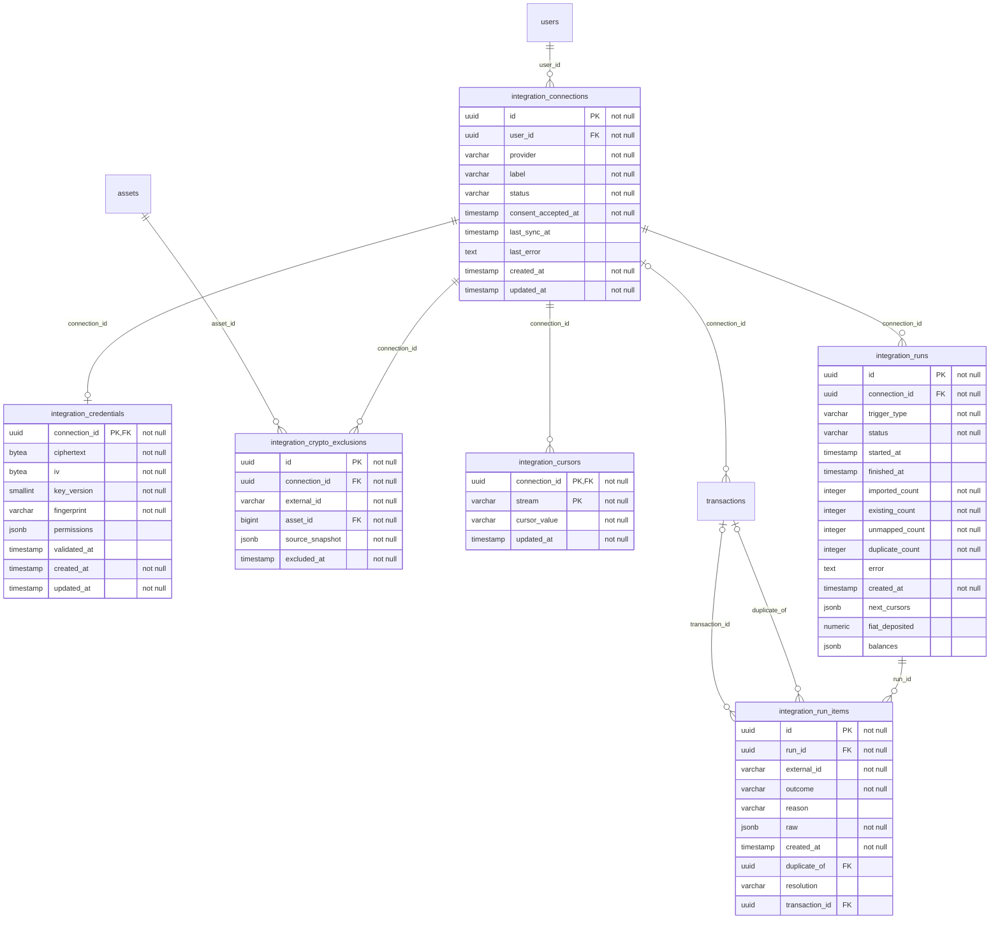
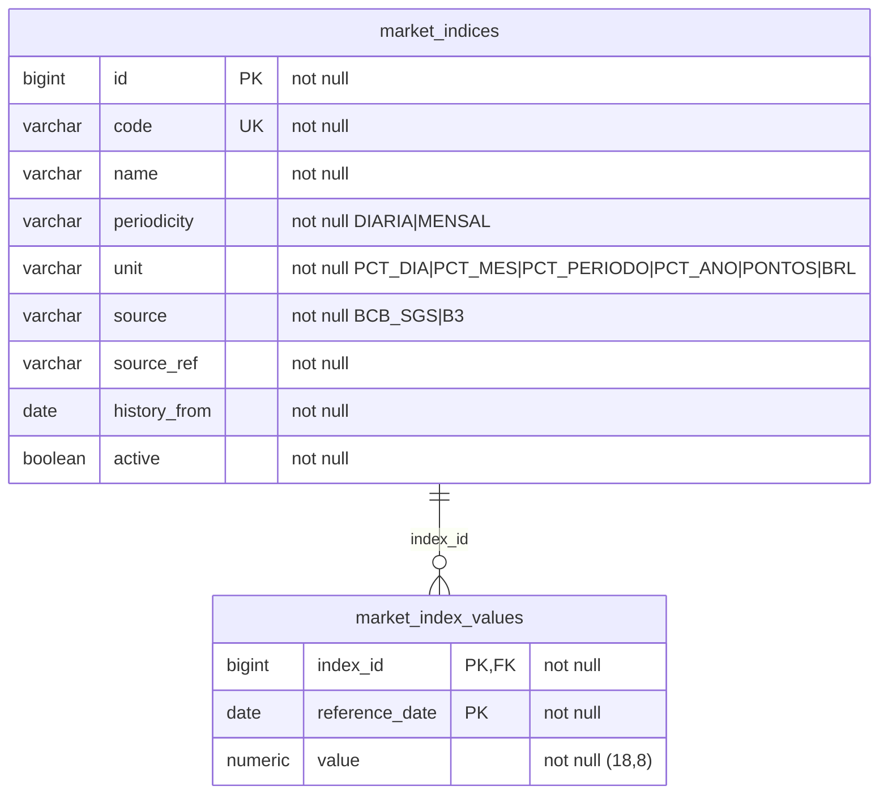
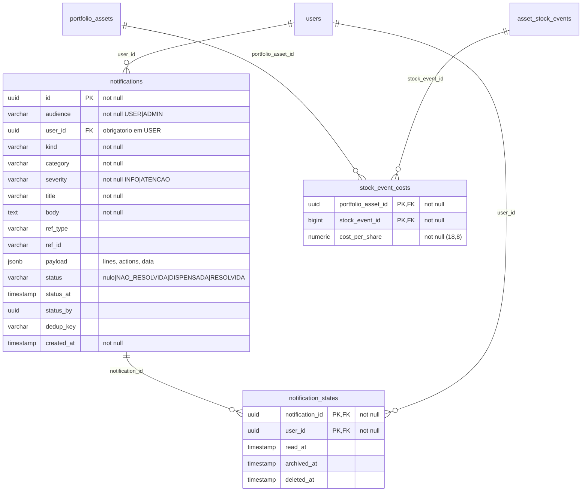

# ACTIVEST_DB — Modelo de dados

> Gerado em 02/10/2026 a partir do banco de desenvolvimento (`db_activest`, Flyway na **V39**), lendo o `information_schema` e as constraints — não do texto do `Claude.md`.
> **31 tabelas** (fora `flyway_schema_history`), **43 chaves estrangeiras**. Acréscimo de 05/10/2026: `market_indices` e
> `market_index_values` (V43, seção 5a — `docs/planos/PLANO_INDICES_MERCADO.md`); V44: `asset_types.price_source` e
> `asset_price_history.source` aceitam `TESOURO` (preço oficial do Tesouro Direto). Acréscimo de 10/10/2026
> (`docs/planos/PLANO_PRECO_TETO.md`): V45 `company_quarters.dividends_paid_q/_ttm`; V46 `ceiling_prices` recriada
> (entradas do modelo PREÇO TETO V2) e `ceiling_price_quarters` (nova). Acréscimo de 13/10/2026
> (`docs/planos/PLANO_NOTIFICACOES.md`): V48 `notifications` e `notification_states` (seção 5b); V49
> `ceiling_prices.alert_enabled/alert_below_ideal/alert_last_on`; V50 `transactions.origin` aceita `SISTEMA` (venda da
> liquidação automática); V51 `stock_event_costs`. Acréscimo de 24/10/2026 (`docs/planos/PLANO_TELA_ATIVOS.md`, depois
> da consolidação em V1–V6): V7 `company_quarters` ganha `gross_profit_q/_ttm`, `depreciation_amortization_q/_ttm`,
> `pretax_income_q/_ttm`, `income_tax_q/_ttm`, `current_assets` e `current_liabilities` (nulas, no fim da tabela);
> `cvm_statement_values.metric` ganha os valores `LUCRO_BRUTO`, `DEPRECIACAO_AMORTIZACAO`, `EXAUSTAO_BIOLOGICA`,
> `LAIR`, `IR_CSLL`, `ATIVO_CIRCULANTE` e `PASSIVO_CIRCULANTE`. Diagramas em Mermaid: o GitHub e o IntelliJ (plugin Mermaid) renderizam.

**A ideia que organiza o schema:** o *catálogo* é global (o que o instrumento É — `assets`, preços, proventos, emissores; gravado pela **adm-api**), e o *papel* é do usuário (posição, transações, título de renda fixa, proventos recebidos; gravado só pela **app-api**).

Legenda das relações: `||--o{` um para muitos (FK obrigatória) · `|o--o{` um para muitos (FK opcional) · `||--o|` um para um. O rótulo é a coluna da FK.

## Sumário

1. [Visão geral](#1-visão-geral)
2. [Usuário e carteira](#2-usuário-e-carteira)
3. [Catálogo de ativos, preços e proventos](#3-catálogo-de-ativos-preços-e-proventos)
4. [Emissores, balanços e indicadores](#4-emissores-balanços-e-indicadores)
5. [Integrações com corretoras](#5-integrações-com-corretoras)
5a. [Índices de mercado](#5a-índices-de-mercado)
6. [Descrição das tabelas](#6-descrição-das-tabelas)
5b. [Notificações](#5b-notificações)
7. [Regras de exclusão (ON DELETE)](#7-regras-de-exclusão-on-delete)

## 1. Visão geral

Todas as tabelas e relações, sem colunas.

```mermaid
erDiagram
    assets ||--o{ asset_cash_events : "asset_id"
    asset_types ||--o{ asset_categories : "asset_type_id"
    assets ||--o{ asset_price_history : "asset_id"
    assets ||--o{ asset_stock_events : "asset_id"
    assets ||--o| asset_terms : "asset_id"
    asset_categories |o--o{ assets : "asset_category_id"
    issuers |o--o{ assets : "issuer_id"
    asset_types ||--o{ assets : "asset_type_id"
    assets ||--o{ ceiling_prices : "asset_id"
    users ||--o{ ceiling_prices : "user_id"
    ceiling_prices ||--o{ ceiling_price_quarters : "ceiling_price_id"
    cvm_documents ||--o{ company_quarters : "source_doc_id"
    issuers ||--o{ company_quarters : "issuer_id"
    issuers ||--o{ cvm_documents : "issuer_id"
    cvm_documents ||--o{ cvm_statement_values : "document_id"
    withholding_tax_rules |o--o{ dividends : "withholding_rule_id"
    asset_cash_events |o--o{ dividends : "cash_event_id"
    portfolio_assets ||--o{ dividends : "portfolio_asset_id"
    issuers ||--o{ fii_monthly : "issuer_id"
    assets ||--o{ fixed_income_notes : "asset_id"
    users ||--o{ fixed_income_notes : "user_id"
    users ||--o{ goals : "user_id"
    users ||--o{ integration_connections : "user_id"
    integration_connections ||--o| integration_credentials : "connection_id"
    assets ||--o{ integration_crypto_exclusions : "asset_id"
    integration_connections ||--o{ integration_crypto_exclusions : "connection_id"
    integration_connections ||--o{ integration_cursors : "connection_id"
    transactions |o--o{ integration_run_items : "transaction_id"
    transactions |o--o{ integration_run_items : "duplicate_of"
    integration_runs ||--o{ integration_run_items : "run_id"
    integration_connections ||--o{ integration_runs : "connection_id"
    assets ||--o{ portfolio_assets : "asset_id"
    fixed_income_notes |o--o{ portfolio_assets : "note_id"
    portfolios ||--o{ portfolio_assets : "portfolio_id"
    users ||--o{ portfolios : "user_id"
    cvm_documents ||--o| share_counts : "document_id"
    asset_types ||--o{ strategies : "asset_type_id"
    users ||--o{ strategies : "user_id"
    users ||--o| strategy_reservations : "user_id"
    portfolio_assets ||--o{ transactions : "portfolio_asset_id"
    fixed_income_notes |o--o{ transactions : "note_id"
    integration_connections |o--o{ transactions : "connection_id"
    assets ||--o{ unit_compositions : "asset_id"
    asset_types ||--o{ withholding_tax_rules : "asset_type_id"
    market_indices ||--o{ market_index_values : "index_id"
```

## 2. Usuário e carteira

Tabelas: `ceiling_prices`, `ceiling_price_quarters`, `dividends`, `fixed_income_notes`, `goals`, `portfolio_assets`, `portfolios`, `strategies`, `strategy_reservations`, `transactions`, `users`.

Aparecem só como referência (de outro domínio): `asset_cash_events`, `asset_types`, `assets`, `integration_connections`, `integration_run_items`, `withholding_tax_rules`.

## 3. Catálogo de ativos, preços e proventos

Tabelas: `asset_cash_events`, `asset_categories`, `asset_price_history`, `asset_stock_events`, `asset_terms`, `asset_types`, `assets`, `withholding_tax_rules`.

Aparecem só como referência (de outro domínio): `ceiling_prices`, `dividends`, `fixed_income_notes`, `integration_crypto_exclusions`, `issuers`, `portfolio_assets`, `strategies`, `unit_compositions`.

## 4. Emissores, balanços e indicadores

Tabelas: `company_quarters`, `cvm_documents`, `cvm_statement_values`, `fii_monthly`, `issuers`, `share_counts`, `unit_compositions`.

Aparecem só como referência (de outro domínio): `assets`.

## 5. Integrações com corretoras

Tabelas: `integration_connections`, `integration_credentials`, `integration_crypto_exclusions`, `integration_cursors`, `integration_run_items`, `integration_runs`.

Aparecem só como referência (de outro domínio): `assets`, `transactions`, `users`.

## 5a. Índices de mercado

Tabelas: `market_indices`, `market_index_values` (V43, 05/10/2026). Sem ligação com outro domínio: a nota de renda fixa
acha a série pelo nome (`fixed_income_notes.indexer` = `market_indices.code`), sem FK.

## 5b. Notificações

Tabelas: `notifications`, `notification_states` (V48, 13/10/2026 — `docs/planos/PLANO_NOTIFICACOES.md`). Dois eixos
independentes: o **status** do assunto mora na mensagem (nulo = informativa; `NAO_RESOLVIDA`/`DISPENSADA`/`RESOLVIDA`), o
**estado** de cada pessoa (lida, arquivada, excluída — exclusão lógica) mora em `notification_states` (sem linha = não
lida, na Entrada). Mensagem de administrador (`audience = ADMIN`) não tem dono: todos os admins a veem, cada um com o
seu estado. `dedup_key` (prefixada pelo `kind`) barra a repetição no banco: informativa nunca se repete; pendência não
se repete enquanto não for resolvida (índices únicos parciais).

## 6. Descrição das tabelas

| Domínio | Tabela | Quem grava | Descrição | Unicidade |
|---|---|---|---|---|
| Usuário | `ceiling_prices` | app-api | Cálculo de preço teto (modelo PREÇO TETO V2, V46) de uma ação pelo usuário: só as entradas, todas obrigatórias — N (shares), ROE, payout, desconto, perpetuidade, margem de segurança (pontos) e preço — com a origem de cada uma (inputs_origin, JSONB: PADRAO/INFORMADO + referência do padrão). O resultado não é gravado: sai das entradas. Um por (user_id, asset_id). | (user_id, asset_id) |
| Usuário | `ceiling_price_quarters` | app-api | Os 4 lucros de um cálculo de preço teto (V46): valor digitado, unidade (UNIDADE/MIL/MILHAO/BILHAO), moeda (BRL/USD), câmbio, valor em reais (value_brl, o que entra no cálculo), origem (PADRAO = CVM sem alteração, INFORMADO). A fonte (source_ref) saiu na V47. | (ceiling_price_id, position) |
| Notificações | `notifications` | app-api e adm-api (as de administrador, D1) | Mensagem da caixa (V48): público, tipo, categoria, gravidade, texto, referência, payload (linhas e ações) e o status do assunto. Repetição barrada pela `dedup_key`. | (audience, user_id, dedup_key) parcial |
| Notificações | `notification_states` | app-api | Estado de uma mensagem para uma pessoa: lida, arquivada, excluída (lógica). | (notification_id, user_id) |
| Usuário | `stock_event_costs` | app-api | Custo por ação de uma bonificação que a B3 não informou, digitado pelo usuário para a posição dele (V51, "Informar custo"). | (portfolio_asset_id, stock_event_id) |
| Usuário | `dividends` | app-api | Proventos da posição, gerados a partir do catálogo (asset_cash_events) × cotas na data-com. Bruto (total_amount), IR retido pela regra vigente e líquido (net_amount). Sem user_id: o dono vem da posição. | — |
| Usuário | `fixed_income_notes` | app-api | O título de renda fixa do usuário (CDB, Tesouro...): emissor, vencimento, forma de remuneração, indexador e taxa contratada. Copia de asset_terms no lançamento. | — |
| Usuário | `goals` | app-api | Metas de investimento: valor alvo, valor atual, data e status. | — |
| Usuário | `portfolio_assets` | app-api | A posição: um ativo (e, na renda fixa, um título) dentro da carteira. Não guarda cotas, preço médio nem custo — saem das transações. Guarda a reserva de emergência (is_reservation), se está liquidada e a valorização. Única por (portfolio_id, asset_id, note_id) com NULLS NOT DISTINCT. | (portfolio_id, asset_id, note_id) |
| Usuário | `portfolios` | app-api | Carteira do usuário (uma por usuário). | — |
| Usuário | `strategies` | app-api | Estratégia de geração de renda: % ideal por tipo de ativo; única por (user_id, asset_type_id). Base do rebalanceamento. | (user_id, asset_type_id) |
| Usuário | `strategy_reservations` | app-api | Estratégia da reserva de emergência, uma por usuário: por percentual (type 1) ou por valor (type 2). | (user_id) |
| Usuário | `transactions` | app-api | Compras e vendas — a fonte da verdade da posição. origin MANUAL ou AUTO (importada de integração, com external_id, source_snapshot e edited_at). note_id só na renda fixa; sale_group_id agrupa a venda FIFO do Tesouro. | — |
| Usuário | `users` | seed V9 (dev) / app-api | Usuários do sistema: login por senha (bcrypt em password_hash) ou Google (google_id); is_admin libera as rotinas de administrador. | (email); (google_id) |
| Catálogo | `asset_cash_events` | adm-api | Proventos do catálogo (dividendo, JCP, rendimento, amortização...) por ativo: data-com, pagamento, valor por cota, parcela (seq). source B3, B3_HISTORICO ou FNET; payment_date_source diz de onde veio a data (nula = da fonte, CVM ou LEVANTAMENTO). | (asset_id, type, data_com, value_per_share, seq) |
| Catálogo | `asset_categories` | seeds | Categoria dentro do tipo (um nível): setor B3 da ação, tipo de FII (Tijolo, Papel...), etc. Única por (asset_type_id, name). | (asset_type_id, name) |
| Catálogo | `asset_price_history` | adm-api | Cotações diárias (OHLCV) por ativo, uma por (asset_id, reference_date). source: B3_COTAHIST (série oficial, vence), BRAPI ou COINGECKO. | (asset_id, reference_date) |
| Catálogo | `asset_stock_events` | adm-api | Eventos societários do catálogo: desdobramento, grupamento e bonificação, com fator e custo atribuído. Ajustam cotas e preço médio da posição. | (asset_id, type, data_com, factor) |
| Catálogo | `asset_terms` | seed V8 | Parâmetros públicos do papel, 1:1 com assets — hoje só Tesouro Direto (vencimento, forma de remuneração, indexador). | — |
| Catálogo | `asset_types` | seed V2 | Os 12 tipos de ativo (Ações, FIIs, Renda Fixa, Tesouro, ETF, BDR, Cripto...), com a fonte de preço (price_source) e se é renda fixa (fixed_income). | (name) |
| Catálogo | `assets` | seeds / adm-api | Catálogo global de instrumentos (sem dono): ticker, nome, tipo, categoria, preço atual, ISIN e a ligação com o emissor (issuer_id, share_class, issuer_link_source). | (ticker) |
| Catálogo | `withholding_tax_rules` | seed V23 | Alíquotas de IR retido na fonte por tipo de provento, tipo de ativo e vigência, com a base legal. Lei nova = migration. | — |
| Emissores | `company_quarters` | adm-api (derivada) | Série trimestral derivada por (issuer_id, period_end): trimestre isolado (_q), 12 meses (_ttm), posição do balanço e ações. Recalculada inteira ao fim de cada carga de balanços. Base dos indicadores. dividends_paid_q/_ttm (V45): dividendos + JCP pagos aos acionistas da controladora (DFC), base do payout desde 10/10/2026. V7 (24/10/2026): lucro bruto, D&A (DVA menos a exaustão biológica), LAIR e IR/CSLL (_q/_ttm) e ativo/passivo circulante — base dos indicadores novos da tela de Ativos. | — |
| Emissores | `cvm_documents` | adm-api | Cada DFP ou ITR entregue à CVM por emissor e data de referência; version (reapresentação substitui) e se é consolidado. | (issuer_id, doc_type, reference_date) |
| Emissores | `cvm_statement_values` | adm-api | Métricas extraídas de cada documento (receita, EBIT, lucro, PL, caixa, dívida, FCO, dividendos declarados, LPA...), em reais, por período. | (document_id, metric, period_start, period_end) |
| Emissores | `fii_monthly` | adm-api | Informe mensal de FII da CVM por (issuer_id, reference_month): PL, cotas, VP por cota, cotistas, taxas, DY, amortização, carteira e passivo. | — |
| Emissores | `issuers` | seed V30 / adm-api | Emissores: companhia aberta ou FII, um por CNPJ. Código CVM, setores CVM e B3, segmento de listagem, administrador do FII e o segmento curado do FII. | (cnpj); (cvm_code) |
| Emissores | `share_counts` | adm-api | Quantidade de ações (e em tesouraria) de cada documento, com a escala conferida (scale_factor, scale_status, scale_check). | — |
| Emissores | `unit_compositions` | seed V30 / adm-api | Composição das units: quantas ações de cada classe (ON, PN...) formam uma unit. | — |
| Índices | `market_indices` | seed V43 | Cadastro dos índices de mercado: código (o mesmo do enum Indexer para CDI, SELIC, IPCA, IGPM, INPC, TR; mais SELIC_META, USD_PTAX, IBOV, IFIX), periodicidade, unidade do valor publicado e a fonte (série do SGS ou sigla da B3). | (code); (source, source_ref) |
| Índices | `market_index_values` | adm-api | Série de cada índice, um valor por data, como a fonte publica (mensal no dia 1º). O acumulado não é gravado: sai do MarketIndexCalculator. | (index_id, reference_date) |
| Integrações | `integration_connections` | app-api | Conexão do usuário com uma corretora (hoje BINANCE): apelido único por usuário, status, aceite do consentimento, última sincronização e erro. | (user_id, label) |
| Integrações | `integration_credentials` | app-api | Credencial cifrada (AES-256-GCM) da conexão, 1:1; nunca sai na API e é apagada na revogação. | — |
| Integrações | `integration_crypto_exclusions` | app-api | Operação importada e excluída pelo usuário: a sincronização não a recria (pode ser restaurada). | (connection_id, external_id) |
| Integrações | `integration_cursors` | app-api | Onde cada fluxo (stream) da corretora parou — sincronização incremental. | — |
| Integrações | `integration_run_items` | app-api | Cada operação trazida numa execução: resultado (nova, existente, não mapeada, possível duplicata), decisão do usuário e a transação gerada. | (run_id, external_id) |
| Integrações | `integration_runs` | app-api | Cada sincronização (manual ou agendada): é também a fila do worker (QUEUED, RUNNING, AWAITING_CONFIRMATION...), com contagens, depósitos e saldos da corretora. | — |

## 7. Regras de exclusão (ON DELETE)

| Tabela | Coluna | Referencia | Ao excluir o pai |
|---|---|---|---|
| `asset_cash_events` | `asset_id` | `assets.id` | bloqueia (NO ACTION) |
| `asset_categories` | `asset_type_id` | `asset_types.id` | bloqueia (NO ACTION) |
| `asset_price_history` | `asset_id` | `assets.id` | bloqueia (NO ACTION) |
| `asset_stock_events` | `asset_id` | `assets.id` | bloqueia (NO ACTION) |
| `asset_terms` | `asset_id` | `assets.id` | CASCADE |
| `assets` | `asset_category_id` | `asset_categories.id` | bloqueia (NO ACTION) |
| `assets` | `issuer_id` | `issuers.id` | bloqueia (NO ACTION) |
| `assets` | `asset_type_id` | `asset_types.id` | bloqueia (NO ACTION) |
| `ceiling_prices` | `asset_id` | `assets.id` | bloqueia (NO ACTION) |
| `ceiling_prices` | `user_id` | `users.id` | CASCADE |
| `ceiling_price_quarters` | `ceiling_price_id` | `ceiling_prices.id` | CASCADE |
| `company_quarters` | `source_doc_id` | `cvm_documents.id` | CASCADE |
| `company_quarters` | `issuer_id` | `issuers.id` | bloqueia (NO ACTION) |
| `cvm_documents` | `issuer_id` | `issuers.id` | bloqueia (NO ACTION) |
| `cvm_statement_values` | `document_id` | `cvm_documents.id` | CASCADE |
| `dividends` | `withholding_rule_id` | `withholding_tax_rules.id` | bloqueia (NO ACTION) |
| `dividends` | `cash_event_id` | `asset_cash_events.id` | bloqueia (NO ACTION) |
| `dividends` | `portfolio_asset_id` | `portfolio_assets.id` | CASCADE |
| `fii_monthly` | `issuer_id` | `issuers.id` | bloqueia (NO ACTION) |
| `fixed_income_notes` | `asset_id` | `assets.id` | bloqueia (NO ACTION) |
| `fixed_income_notes` | `user_id` | `users.id` | CASCADE |
| `goals` | `user_id` | `users.id` | CASCADE |
| `integration_connections` | `user_id` | `users.id` | CASCADE |
| `integration_credentials` | `connection_id` | `integration_connections.id` | CASCADE |
| `integration_crypto_exclusions` | `asset_id` | `assets.id` | bloqueia (NO ACTION) |
| `integration_crypto_exclusions` | `connection_id` | `integration_connections.id` | CASCADE |
| `integration_cursors` | `connection_id` | `integration_connections.id` | CASCADE |
| `integration_run_items` | `transaction_id` | `transactions.id` | SET NULL |
| `integration_run_items` | `duplicate_of` | `transactions.id` | SET NULL |
| `integration_run_items` | `run_id` | `integration_runs.id` | CASCADE |
| `integration_runs` | `connection_id` | `integration_connections.id` | CASCADE |
| `market_index_values` | `index_id` | `market_indices.id` | bloqueia (NO ACTION) |
| `notifications` | `user_id` | `users.id` | CASCADE |
| `notification_states` | `notification_id` | `notifications.id` | CASCADE |
| `notification_states` | `user_id` | `users.id` | CASCADE |
| `stock_event_costs` | `portfolio_asset_id` | `portfolio_assets.id` | CASCADE |
| `stock_event_costs` | `stock_event_id` | `asset_stock_events.id` | CASCADE |
| `portfolio_assets` | `asset_id` | `assets.id` | bloqueia (NO ACTION) |
| `portfolio_assets` | `note_id` | `fixed_income_notes.id` | bloqueia (NO ACTION) |
| `portfolio_assets` | `portfolio_id` | `portfolios.id` | CASCADE |
| `portfolios` | `user_id` | `users.id` | CASCADE |
| `share_counts` | `document_id` | `cvm_documents.id` | CASCADE |
| `strategies` | `asset_type_id` | `asset_types.id` | bloqueia (NO ACTION) |
| `strategies` | `user_id` | `users.id` | CASCADE |
| `strategy_reservations` | `user_id` | `users.id` | CASCADE |
| `transactions` | `portfolio_asset_id` | `portfolio_assets.id` | CASCADE |
| `transactions` | `note_id` | `fixed_income_notes.id` | bloqueia (NO ACTION) |
| `transactions` | `connection_id` | `integration_connections.id` | SET NULL |
| `unit_compositions` | `asset_id` | `assets.id` | CASCADE |
| `withholding_tax_rules` | `asset_type_id` | `asset_types.id` | bloqueia (NO ACTION) |

> Apagar um usuário leva junto (CASCADE) carteira, posições, transações, títulos, proventos, estratégias, metas, preços teto e conexões. Nada do catálogo depende de usuário.
