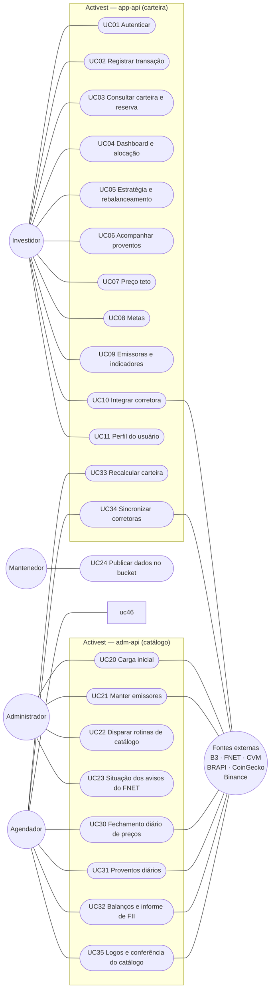
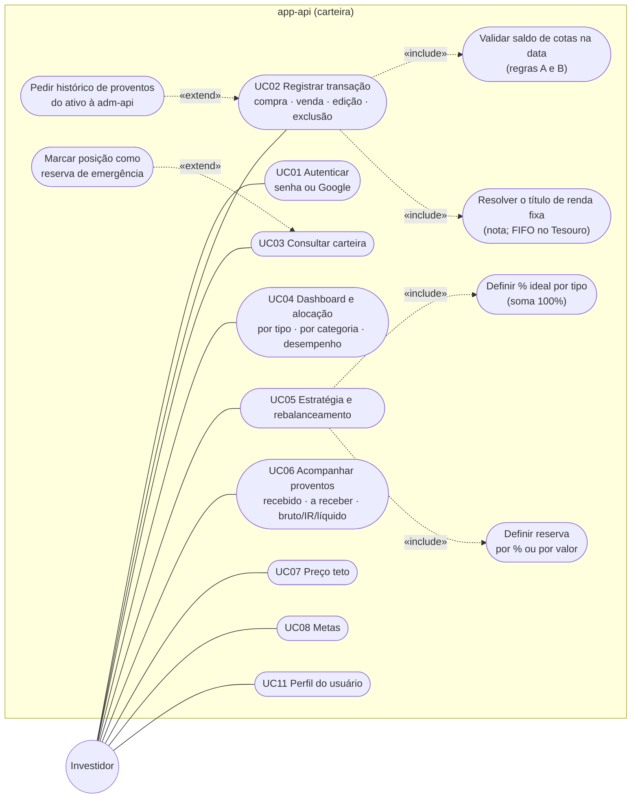
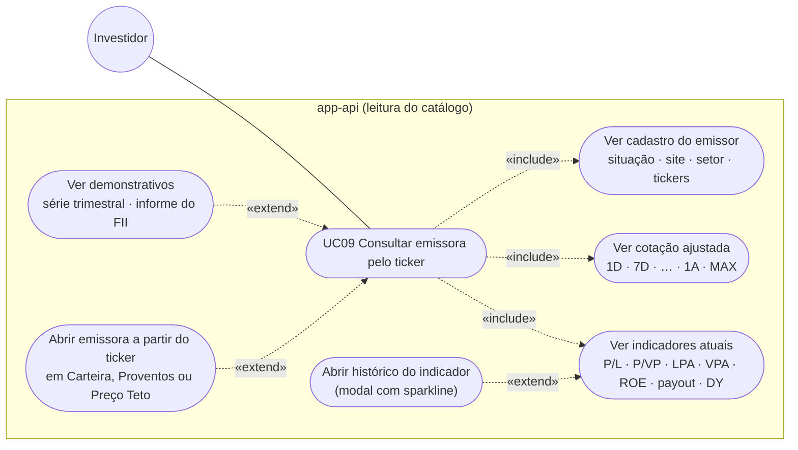
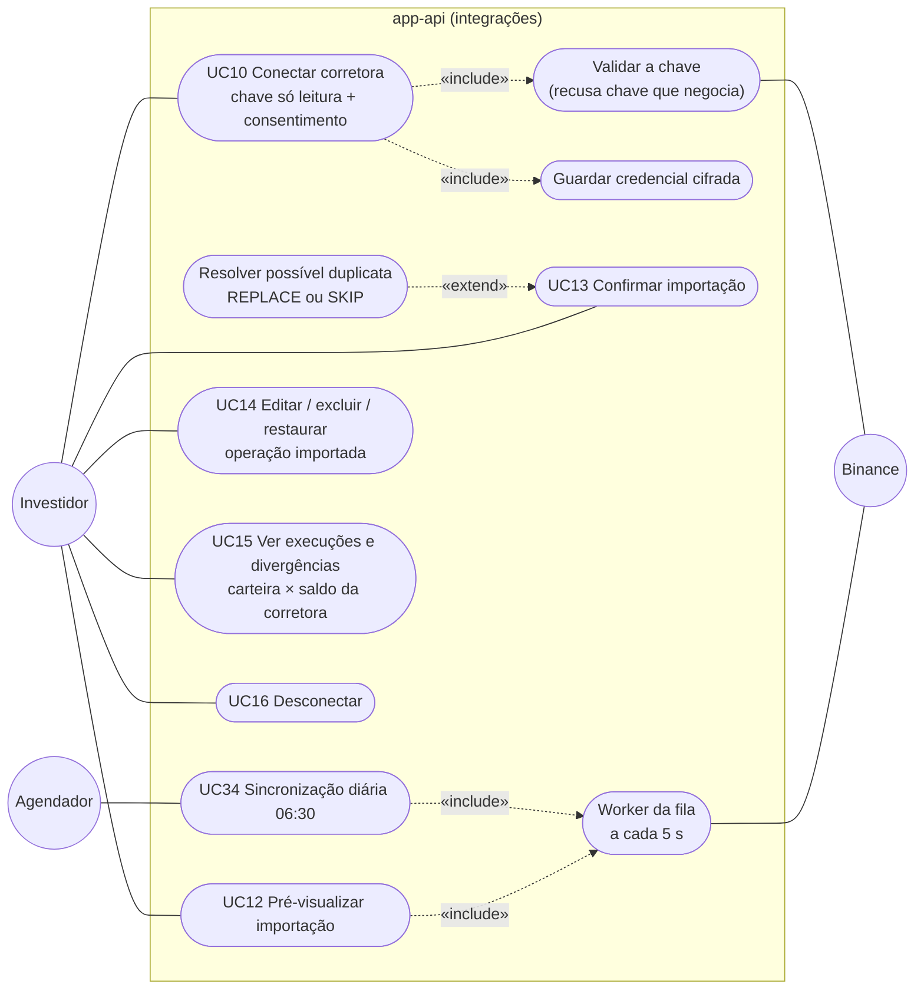
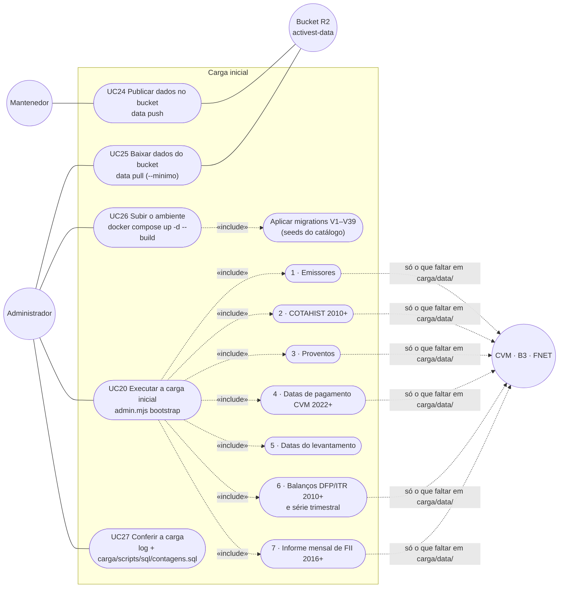
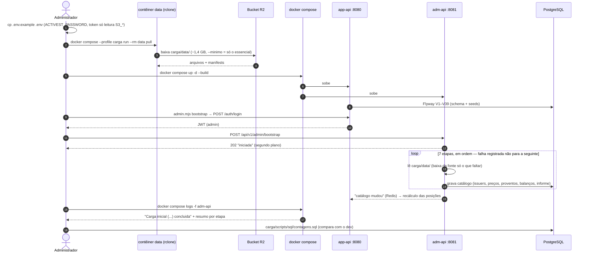
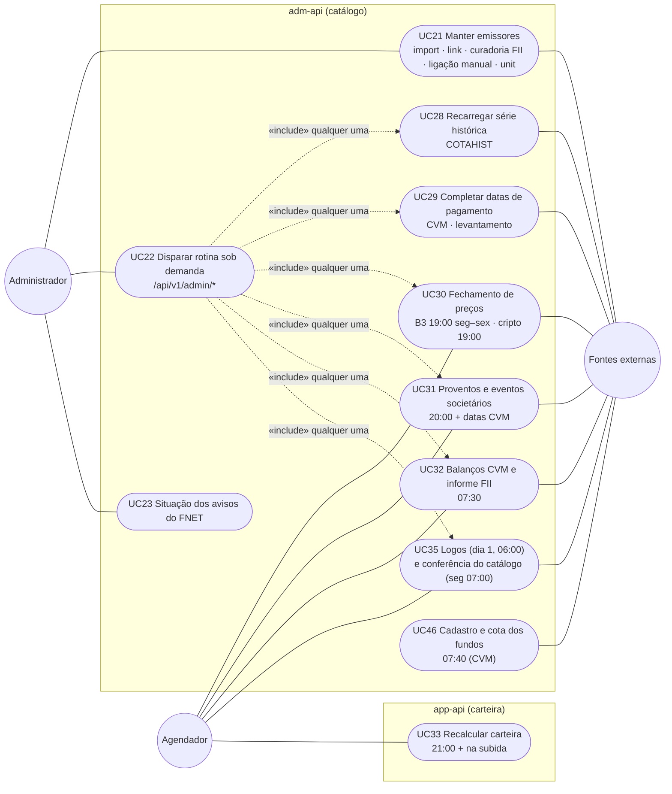
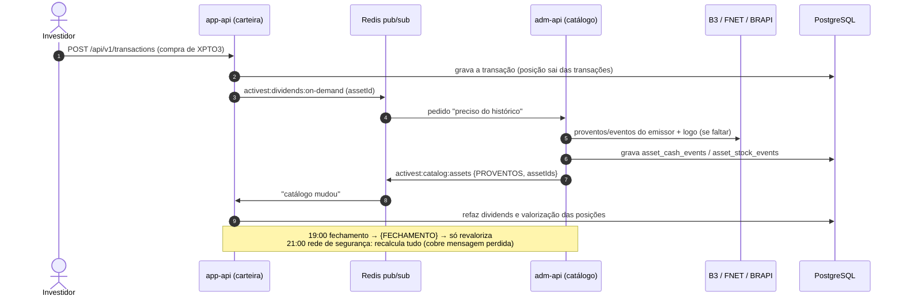

# USE_CASES — Casos de uso do Activest

> Gerado em 02/10/2026 a partir do código (controllers da app-api e da adm-api, rotinas agendadas, telas do
> `activest-web`) e do `carga/scripts/README.md` · 27/10/2026: UC46–UC47 (fundos de investimento da CVM) · 05/10/2026: UC36–UC38 (índices de mercado) · 10/10/2026: UC07 refeito
> (Preço Teto pelo modelo PREÇO TETO V2) e UC41 (cotações diárias do catálogo pelo COTAHIST). Diagramas em Mermaid (o GitHub e o IntelliJ renderizam).
> Mermaid não tem diagrama UML de caso de uso nativo: os atores aparecem como círculos, os casos de uso como
> elipses dentro da fronteira do sistema, e `«include»`/`«extend»` como setas tracejadas.

## Sumário

1. [Atores](#1-atores)
2. [Visão geral](#2-visão-geral)
3. [Carteira do investidor](#3-carteira-do-investidor)
4. [Emissoras e indicadores](#4-emissoras-e-indicadores)
5. [Integração com corretora](#5-integração-com-corretora)
6. [Carga inicial (máquina nova)](#6-carga-inicial-máquina-nova)
7. [Manutenção do catálogo (administrador e agendador)](#7-manutenção-do-catálogo-administrador-e-agendador)
8. [Catálogo × carteira: como as duas APIs conversam](#8-catálogo--carteira-como-as-duas-apis-conversam)
9. [Fichas dos casos de uso](#9-fichas-dos-casos-de-uso)

---

## 1. Atores

| Ator | Quem é | Por onde entra |
|---|---|---|
| **Investidor** | Usuário logado, dono da carteira | Front (5173) → app-api (8080) |
| **Administrador** | Usuário com `users.is_admin = true` | `carga/scripts/admin.mjs` / Swagger → adm-api (8081) |
| **Mantenedor (produtor de dados)** | Quem tem a chave de escrita do bucket R2 (hoje, o Guilherme) | contêiner `data` (`data push`) |
| **Agendador** | O relógio das APIs (`@Scheduled`, fuso de São Paulo) | rotinas da adm-api e da app-api |
| **Fontes externas** | B3, FNET, CVM, BRAPI, CoinGecko, Binance | chamadas da adm-api (catálogo) e da app-api (só Binance) |
| **Bucket R2** | `activest-data` (Cloudflare), cópia de referência da pasta `carga/data/` | contêiner `data` (`data pull` / `data push`) |

---

## 2. Visão geral

---

## 3. Carteira do investidor

Pontos do fluxo que valem lembrar:

- A **posição não é gravada**: cotas, preço médio e custo saem das transações; editar uma transação muda a carteira
  na hora. Eventos societários (desdobramento, grupamento, bonificação) do catálogo ajustam as cotas.
- Depois de cada transação, a app-api publica "preciso do histórico" (Redis) e a adm-api traz os proventos e o logo do
  ativo — ver a [seção 8](#8-catálogo--carteira-como-as-duas-apis-conversam).
- A carteira e o Dashboard somam só o provento **líquido já recebido**; o a receber aparece na tela de proventos.

---

## 4. Emissoras e indicadores

Os indicadores são **calculados na consulta** (serviço/DTO, nada gravado) a partir de `company_quarters`,
`fii_monthly`, `asset_cash_events` e `asset_price_history`. A cotação é sempre ajustada por desdobramento,
grupamento e bonificação (não por proventos).

---

## 5. Integração com corretora

A fila é a própria `integration_runs`: pedir a sincronização responde na hora (202, `QUEUED`) e o worker busca
na corretora uma execução por vez. A execução agendada se confirma sozinha quando não há nada a decidir e a
conexão já teve uma importação confirmada pelo usuário.

---

## 6. Carga inicial (máquina nova)

Objetivo: subir o Activest numa máquina nova **só com o repositório + o bucket**, sem nada fora do projeto, e
chegar ao catálogo completo. O banco nasce das migrations (tipos, categorias, ativos, Tesouro, IR, emissores e
ligações já vêm de seed); o volume vem dos arquivos de `carga/data/`.

### 6.1 Casos de uso

### 6.2 Sequência

Regras da carga:

- **Manual**: nunca dispara sozinha ao subir a API.
- **Retomável**: toda etapa é idempotente e o que já está em `carga/data/` não é baixado de novo — rodar de novo
  completa o que faltou. Uma carga por vez.
- **Ordem importa**: COTAHIST antes dos proventos (traz o ISIN que casa a B3); proventos antes dos balanços (a
  escala das ações usa os grupamentos/desdobramentos gravados).
- Dados reais do usuário (extratos da B3, em `carga/mocks/`, fora do git) **não** fazem parte da carga inicial.

---

## 7. Manutenção do catálogo (administrador e agendador)

Detalhe de cada rotina e endpoint: `docs/SCHEDULE_TASKS.md` e `docs/ADM_TASKS.md`.

---

## 8. Catálogo × carteira: como as duas APIs conversam

A regra: a **adm-api grava só catálogo**; a **app-api é a única que grava dado de usuário**. A app-api nunca chama
fonte externa de catálogo (a Binance é dado do usuário).

---

## 9. Fichas dos casos de uso

Prefixo das rotas: `/api/v1`. Investidor = qualquer usuário logado; Admin = `is_admin`.

| UC | Nome | Ator | O que faz | Rotas / gatilho |
|---|---|---|---|---|
| UC01 | Autenticar | Investidor | Cadastro com código por e-mail (e aceite dos termos), login por senha ou Google, esqueci a senha, renovação do token (JWT) — docs/planos/PLANO_CADASTRO_USUARIO.md | `GET /auth/signup/enabled`, `POST /auth/signup/{start,resend,confirm}`, `/auth/login`, `/auth/google`, `/auth/refresh`, `/auth/password/{forgot,resend,reset}` |
| UC02 | Registrar transação | Investidor | Compra/venda de RV, RF e Tesouro; edita, exclui, restaura importada. Recusa venda sem saldo na data, RF sem título, dois títulos do Tesouro no mesmo dia | `POST/GET/PUT/DELETE /transactions/`, `POST /transactions/{id}/restore` |
| UC03 | Consultar carteira e reserva | Investidor | Posições com cotas, PM, custo, valorização, emissor/vencimento da RF; liga/desliga reserva de emergência | `GET /portfolio/`, `/portfolio/assets`, `PATCH /portfolio/assets/{id}/reservation` |
| UC04 | Dashboard e alocação | Investidor | Alocação por tipo e por categoria, com ou sem reserva; desempenho | `GET /portfolio/allocation`, `/allocation/detailed`, `/allocation/reservation`, `/portfolio/performance` |
| UC05 | Estratégia e rebalanceamento | Investidor | % ideal por tipo (soma 100%, PUT substitui tudo), reserva por % ou valor, sugestão de aporte | `GET/PUT /strategy/`, `GET/PUT /strategy/reservation`, `GET /strategy/rebalance` |
| UC06 | Acompanhar proventos | Investidor | Resumo recebido × a receber, por tipo e por ativo, bruto, IR retido e líquido | `GET /dividends/`, `/dividends/asset/{ticker}`, `/portfolio/dividends` |
| UC07 | Preço teto | Investidor | Calcular o Preço Teto e o Preço Ideal de uma ação pelo modelo PREÇO TETO V2 (docs/planos/PLANO_PRECO_TETO.md): formulário com os padrões do catálogo (4 lucros da CVM, ações sem tesouraria, ROE e payout médios de 3 anos, Selic meta, 3%, 15%, último fechamento), ↻ por campo e "Restaurar todos os padrões", resultado ao vivo com alertas; salvar (entradas obrigatórias, alertas confirmados), editar, excluir; lista comparando teto e ideal com o preço do cálculo, o fechamento do dia e o preço médio | `GET /ceiling-prices`, `/ceiling-prices/defaults/{ticker}`, `/ceiling-prices/{id}`, `POST /ceiling-prices/calculate`, `POST /ceiling-prices`, `PUT/DELETE /ceiling-prices/{id}` |
| UC08 | Metas | Investidor | Definir metas pelo catálogo de 17 tipos (patrimônio, aportes, renda passiva, rentabilidade, alocação, risco, por ativo, longo prazo) — o Activest calcula situação, progresso e projeção a partir da carteira (`docs/planos/PLANO_METAS.md`); pausar, retomar, concluir, arquivar, excluir a arquivada; evolução e alterações | `GET /goals/types`, `/goals/scope-options`, `POST /goals/preview`, `GET/POST /goals`, `GET/PUT/DELETE /goals/{id}`, `POST /goals/{id}/{pause,resume,complete,archive,unarchive}`, `GET /goals/{id}/history`, `/events` |
| UC09 | Emissoras e indicadores | Investidor | Busca de ativo, cadastro do emissor, cotação ajustada por período, indicadores atuais e históricos, série trimestral e informe do FII | `GET /assets/`, `/assets/{ticker}`, `/assets/{ticker}/prices`, `/assets/{ticker}/indicators[/history]`, `/issuers/{id}[/quarters\|/months]`, `/assets/{ticker}/logo` |
| UC10 | Conectar corretora | Investidor | Chave só leitura + consentimento; credencial cifrada; mostra só os 4 últimos caracteres | `GET/POST /integrations/connections` |
| UC11 | Perfil do usuário | Investidor | Ver e alterar os próprios dados (nome, celular, CPF), tema, senha, e-mail com código, vínculo Google, novo aceite dos termos, excluir a conta com código | `GET/PUT/DELETE /users/me`, `PUT /users/me/{preferences,password}`, `POST /users/me/{email,email/confirm,google,terms,delete-request}`, `DELETE /users/me/google` |
| UC12 | Pré-visualizar importação | Investidor | Pede a busca na corretora (fila); mostra novas, já importadas, não mapeadas, possíveis duplicatas | `POST /integrations/connections/{id}/preview`, `GET …/runs/{runId}` |
| UC13 | Confirmar importação | Investidor | Grava as operações como transações `AUTO`; possível duplicata exige REPLACE ou SKIP | `POST …/runs/{runId}/confirm`, `…/cancel` |
| UC14 | Editar/excluir/restaurar importada | Investidor | Edição marca `editedAt`; exclusão registra para não recriar; restaurar volta aos valores da corretora | `PUT/DELETE /transactions/{id}`, `POST /transactions/{id}/restore`, `GET …/exclusions`, `POST …/exclusions/{id}/restore` |
| UC15 | Execuções e divergências | Investidor | Histórico de execuções; ativos em que a carteira difere do saldo da corretora | `GET …/runs`, `GET /integrations/connections` |
| UC16 | Desconectar | Investidor | Apaga a credencial e marca `REVOKED` | `DELETE /integrations/connections/{id}` |
| UC17 | Notificações | Investidor / Admin | Caixa estilo e-mail aberta pelo sino do menu (docs/planos/PLANO_NOTIFICACOES.md): Entrada/Arquivadas, filtros, abrir (marca lida), marcar não lida, arquivar/desarquivar, excluir (lógica), em lote; dispensar/reabrir pendência; ação da mensagem (link, "Informar custo"); as de administrador só para `is_admin` | `GET /notifications`, `/notifications/summary`, `/notifications/{id}`, `POST /notifications/{id}/open`, `PATCH /notifications/state`, `/notifications/{id}/status` |
| UC18 | Informar custo da bonificação | Investidor | Bonificação sem custo da B3: valor por ação para a posição; recalcula o preço médio e resolve a pendência | `PUT /portfolio/assets/{id}/stock-events/{eventId}/cost` |
| UC19 | Alerta de preço do Preço Teto | Investidor | Liga/desliga "alertar preço abaixo do ideal" por cálculo | `PATCH /ceiling-prices/{id}/alert` |
| UC20 | Carga inicial | Admin | 7 etapas em ordem, retomável (seção 6) | `POST /admin/bootstrap` · `admin.mjs bootstrap` |
| UC21 | Manter emissores | Admin | Importar emissores, ligar ativos, lista curada de CNPJs de FII, ligação manual, composição de unit | `POST /admin/issuers/import`, `/issuers/link`, `/issuers/fii-cnpjs`, `PUT /admin/assets/{id}/issuer`, `/unit-composition` |
| UC22 | Disparar rotina de catálogo | Admin | Qualquer rotina na hora (202, resultado no log) | `POST /admin/closing`, `/proventos`, `/logos`, `/catalog-audit`, `/cvm/import`, `/cvm/quarters`, `/cvm/fii-monthly` |
| UC23 | Situação dos avisos do FNET | Admin | Grava se cada aviso de rendimento de FII está ativo, inativo ou cancelado no FNET; aviso inativo não vira provento (21/10/2026, `docs/planos/PLANO_CORRECAO_PROVENTOS.md`) | `POST /admin/dividends/fnet-status` |
| UC24 | Publicar dados no bucket | Mantenedor | Sobe o que é novo em `carga/data/` e regrava os manifests; nunca apaga no bucket | `docker compose --profile carga run --rm data push` |
| UC25 | Baixar dados do bucket | Admin | Baixa `carga/data/` na primeira subida | `… data pull [--minimo]` |
| UC26 | Subir o ambiente | Admin | db, redis, app-api, adm-api, web; migrations ao subir | `docker compose up -d --build` |
| UC27 | Conferir a carga | Admin | Log da adm-api e contagens do catálogo | `docker compose logs -f adm-api`, `carga/scripts/sql/contagens.sql` |
| UC28 | Recarregar série histórica | Admin | COTAHIST de um período | `POST /admin/b3/cotahist?from&to` |
| UC29 | Completar datas de pagamento | Admin | Relatórios da CVM (2022+) e levantamento | `POST /admin/cvm/payment-dates`, `/admin/dividends/payment-date-survey` |
| UC30 | Fechamento de preços | Agendador | BRAPI (B3, ativos em carteira) e CoinGecko; recupera na subida | 19:00 seg–sex (B3) e diário (cripto) |
| UC31 | Proventos diários | Agendador | B3 por emissor, FNET para FII, histórico longo, datas da CVM | 20:00 diário |
| UC32 | Balanços e informe FII | Agendador | DFP/ITR e informe do ano corrente e anterior | 07:30 diário |
| UC33 | Recalcular carteira | Agendador | Proventos e valorização de todas as posições; IR pendente na subida | 21:00 diário + subida da app-api |
| UC34 | Sincronizar corretoras | Agendador | Enfileira as conexões ativas; o worker busca | 06:30 diário; worker a cada 5 s |
| UC35 | Logos e conferência | Agendador | Logos que faltam; tickers novos/sumidos/renomeados e índices atrasados (log e mensagem de administrador desde 13/10/2026) | dia 1 06:00; segunda 07:00 |
| UC36 | Índices de mercado diários | Agendador | CDI, Selic, IPCA, IGP-M, INPC, TR, meta Selic, PTAX (SGS do BCB), Ibovespa e IFIX (B3); janela de revisão; recupera na subida (05/10/2026) | 10:00 diário |
| UC37 | Carregar índices de mercado | Admin | Histórico por índice e ano (padrão 2010 até hoje), ou a rodada incremental | `POST /admin/indices?codes&from&to&recent` |
| UC39 | Preço do Tesouro | Agendador / Admin | PU de venda oficial de cada título; o Tesouro passa a valer cotas × PU | 08:00 diário; `POST /admin/treasury` |
| UC40 | Valorizar renda fixa privada | Agendador | Curva da taxa contratada (CDI, Selic, IPCA…), por transação, índice novo, 21:00 e subida | por evento e 21:00 |
| UC42 | Abertura do dia | Agendador | Liquida os títulos vencidos (venda SISTEMA), avisa proventos pagos e eventos com data-ex no dia, confere bonificação sem custo, avisos de catálogo, alerta de preço e "padrão mudou" (docs/planos/PLANO_NOTIFICACOES.md, 13/10/2026) | 00:00 diário + subida da app-api |
| UC41 | Cotações diárias do catálogo | Agendador / Admin | COTAHIST da B3 pregão a pregão para todas as ações e FIIs (sem cota da BRAPI), completando os dias que faltam; recupera na subida (10/10/2026) | 21:30 e 08:30 diário; `POST /admin/b3/cotahist/daily` |
| UC43 | Câmbio das moedas | Agendador / Admin | PTAX do BCB (compra e venda, boletim de fechamento) das moedas cadastradas desde 2010; no máximo uma rodada automática por dia; aviso de fonte desatualizada (26/10/2026) | 13:30 diário; Run na tela de Tarefas |
| UC44 | Cadastrar moedas | Admin | Tela Moedas: incluir, editar e ativar moedas; gráfico do câmbio; regras de tributo do exterior em consulta (docs/planos/PLANO_CADASTRO_MOEDAS.md) | `/currencies`; `GET/POST/PUT /admin/currencies` (adm-api) |
| UC45 | Lançar ativo em outra moeda | Investidor | Transação na moeda do ativo com o câmbio da data (PTAX venda, editável); venda com IR estimado do exterior; provento com retenção do país de origem | `/transactions`; `POST /transactions`, `GET /currencies/{code}/rate` |
| UC46 | Cadastro e cota dos fundos | Agendador / Admin | Fundos de investimento da CVM no catálogo (~55 mil, ticker = CNPJ, nome curto nas telas), última cota de todos os vivos e a série dos fundos em carteira; no máximo uma rodada automática por dia; avisos de fonte (27/10/2026, docs/planos/PLANO_FUNDOS_INVESTIMENTO.md) | 07:40 diário (tarefa `FUND_QUOTES`, Run com `FROM_MONTH`); etapa "fundos" do `POST /admin/bootstrap` |
| UC47 | Lançar fundo de investimento | Investidor | Busca por nome ou CNPJ (encerrados no "Mostrar N"); Valor e Cota (pré-preenchida da CVM) → cotas calculadas; resgate pelo bruto com IR/IOF pelo PEPS e come-cotas; Previdência vale bruto; a série desde 2010 entra sozinha depois da primeira compra | `GET /assets/?typeId=&query=&includeInactive=`, `GET /funds/{ticker}/quote`, `POST /transactions/`, `POST /transactions/sale-preview` |
| UC38 | Consultar índices | Investidor | Tela Índices: um card por índice com período (1D…MAX, de/até) e gráfico; lista, série e acumulado no período (% do índice, spread; nível para Ibovespa/IFIX/dólar) | `/indices`; `GET /indices`, `/indices/{code}/chart`, `/history`, `/accumulated` |
